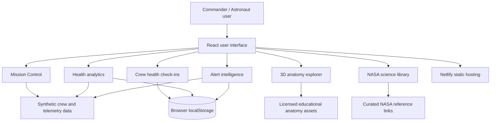

# AstroVitals PAK — Architecture

## High-level architecture

## Runtime model

The application is a static single-page React application built with Vite. Netlify serves the production bundle from `dist/`. Client-side navigation is supported by the SPA fallback configuration.

## Data domains

| Domain | Source | Persistence |
|---|---|---|
| Crew profiles | Synthetic demo data | Application data |
| Simulated telemetry | Local simulator/demo data | In-memory / app-defined |
| Manual check-ins | User-entered demonstration values | Browser localStorage |
| Routines | User-configured demo tasks | Browser localStorage |
| Alert acknowledgement | Local workflow state | Browser localStorage where implemented |
| Science context | Curated source-linked project data | Static application data |
| Anatomy | Third-party educational 3D asset | Static/remote asset loading as configured |

Manual check-ins and simulated telemetry must remain clearly separated in both UI and analytics.

## Build and deployment

- Runtime: Node.js 20.19+ or 22.12+
- Install: `npm ci`
- Development: `npm run dev`
- Build: `npm run build`
- Preview: `npm run preview`
- Netlify build command: `npm run build`
- Netlify publish directory: `dist`

## Security and privacy boundaries

There is no backend authentication or protected health-data store. A role selector, if shown, is a prototype UI control and not a security boundary. localStorage is browser-local and is not encrypted medical storage. Never enter real astronaut or patient records.

## Scientific boundaries

The app's baselines, statistical comparisons, status colors, and alert levels are demonstration logic. They are not clinical reference ranges, diagnoses, treatment instructions, or validated risk predictions. NASA references are contextual sources, not validation of the prototype's algorithms.
